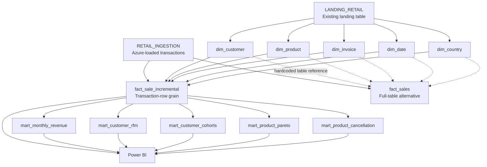

# Data Model & Transformation Design

**Project:** Retail Analytics Engineering Platform  
**Warehouse:** Snowflake  
**Transformation framework:** dbt  
**Source of truth for this document:** exported dbt SQL and YAML files from the project backup

## 1. Model Overview

The project transforms historical Online Retail transaction records into dimensional tables, a transaction-grain sales fact, and five purpose-built analytics marts. dbt models are defined under `models/marts/` in the exported project. The current project name in `dbt_project.yml` is `my_new_project`.

> **Important source distinction:** The five dimensions are constructed from `RETAIL_DB.LANDING.LANDING_RETAIL`. Both sales fact models read transaction records from `RETAIL_DB.LANDING.RETAIL_INGESTION`. These are two existing source tables; the repository does not establish that they are automatically synchronized. The original implementation is intentionally preserved.

### Logical lineage



**Reading the diagram:** Solid dbt model arrows represent dependencies declared with `ref()` in the incremental fact and analytics marts. The dotted arrows to `fact_sales` represent its hardcoded Snowflake dimension-table joins, not dbt `ref()` dependencies. Physical database foreign-key constraints are **not** defined by these SQL joins.

## 2. Dimensions

Every dimension model is materialized as a Snowflake **table**. Records are derived from `LANDING_RETAIL`; identifiers are cleaned and deterministic MD5 keys are generated in SQL.

| dbt model | Grain | Primary / surrogate key | Source business key | Important attributes |
|---|---|---|---|---|
| `dim_customer` | One valid distinct customer ID | `CUSTOMER_KEY` = MD5(customer ID text) | `CUSTOMER_ID` (from source `CUSTOMERID`) | `CUSTOMER_ID` |
| `dim_product` | One non-null stock code | `PRODUCTKEY` = MD5(stock code) | `STOCKCODE` | `DESCRIPTION` (chosen by `MAX(description)`) |
| `dim_invoice` | One non-blank invoice number | `INVOICE_KEY` = MD5(invoice number) | `INVOICENO` | `INVOICENO` |
| `dim_date` | One successfully parsed transaction date | `DATE_KEY` = MD5(`YYYY-MM-DD`) | `DATE` | `MONTH`, `YEAR` |
| `dim_country` | One non-blank country | `COUNTRY_KEY` = MD5(country) | `COUNTRY` | `COUNTRY` |

**Transformation details:**

- Customer IDs are converted using `TRY_TO_NUMBER(..., 38, 0)`; null/invalid IDs are omitted from `dim_customer`.
- Product descriptions are selected using `MAX(description)` per stock code. This is a deterministic aggregation, **not** a latest-description rule.
- The date dimension parses source date strings using `DD-MM-YYYY HH24:MI` and contains only distinct dates appearing in the historical landing table (not a continuous calendar).
- Invoice and country values are trimmed; blank identifiers are excluded.
- MD5 keys are deterministic hash-based surrogate identifiers, not warehouse identity columns.

## 3. Transaction Fact Models

### Primary fact: `fact_sale_incremental`

**Grain:** One row per distinct ingested **source file row**, identified by `SOURCE_ROW_ID`. This is a **transaction line**, not an invoice-level aggregate.

| Field | Meaning |
|---|---|
| `SOURCE_ROW_ID` | Unique row identifier carried from `RETAIL_INGESTION`; configured dbt incremental unique key |
| `INVOICE_KEY` | Lookup to `dim_invoice.INVOICE_KEY` |
| `CUSTOMER_KEY` | Nullable lookup to `dim_customer.CUSTOMER_KEY` |
| `PRODUCT_KEY` | Lookup to `dim_product.PRODUCTKEY` |
| `DATE_KEY` | Lookup to `dim_date.DATE_KEY` |
| `COUNTRY_KEY` | Lookup to `dim_country.COUNTRY_KEY` |
| `INVOICENO` | Invoice number returned from matched invoice dimension |
| `STOCKCODE` | Product code returned from matched product dimension |
| `CUSTOMER_ID` | Source customer identifier |
| `INVOICE_DATE` | Parsed calendar date |
| `QUANTITY` | Signed unit quantity; returns/cancellations may be negative |
| `UNIT_PRICE` | Unit price cast to `NUMBER(12,2)` |

**Transformation sequence:**

1. Read `RETAIL_DB.LANDING.RETAIL_INGESTION`.
2. Trim and standardize identifiers, parse invoice dates and cast quantities/prices.
3. On incremental runs, filter out source IDs that already exist in the target table.
4. `LEFT JOIN` to each of the five dimensions through dbt `ref()` dependencies, using the cleaned business keys.
5. Persist the result in Snowflake using dbt incremental materialization.

Relevant dbt configuration from the exported SQL:

```sql
{{
    config(
        materialized='incremental',
        incremental_strategy='merge',
        unique_key='SOURCE_ROW_ID',
        on_schema_change='fail'
    )
}}
```

The SQL also applies an incremental-only filter:

```sql

    WHERE SOURCE_ROW_ID NOT IN (
        SELECT SOURCE_ROW_ID FROM {{ this }}
    )

```

**Operational implication:** Although `merge` is configured, existing `SOURCE_ROW_ID` values do not pass through normal incremental runs. The current implementation therefore operates as **insert-only for already-seen IDs**; upstream changes to existing records are not propagated without a suitable rebuild or code change.

**Join behavior:** Every dimension join is a `LEFT JOIN`, so missing dimension matches can yield null foreign keys. The fact YAML includes `not_null` checks for `INVOICE_KEY`, `PRODUCT_KEY`, `DATE_KEY`, and `COUNTRY_KEY`. It does **not** enforce `not_null` on `CUSTOMER_KEY`, because the source has missing customer IDs. The exported YAML does not declare explicit dbt `relationships` tests for these foreign keys.

### Secondary fact: `fact_sales`

`fact_sales` is a separately materialized **table** built from `RETAIL_INGESTION`, with a similar line-level field set. Unlike the incremental model, it performs a full query without the incremental filter. It uses hardcoded joins to `RETAIL_DB.DBT_GKS.DIM_*` objects instead of `ref()` for dimensions.

The exported analytics marts all reference **`fact_sale_incremental`**, not `fact_sales`. The latter is retained as part of the original project; it should not be presented as the primary mart input.

## 4. Analytics Marts

All five marts reference `{{ ref('fact_sale_incremental') }}`. No explicit materialization overrides appear in their SQL, so the project-level `+materialized: view` setting applies unless changed elsewhere at runtime.

| Mart | Intended grain | Key outputs | Business purpose |
|---|---|---|---|
| `mart_monthly_revenue` | One calendar month | `REVENUE_MONTH`, `TRANSACTION_ROWS`, `NET_REVENUE`, `PREVIOUS_MONTH_REVENUE`, `MOM_GROWTH_PCT` | Revenue trend and month-over-month growth |
| `mart_customer_rfm` | One customer ID with qualifying purchases | `RECENCY_DAYS`, `FREQUENCY`, `MONETARY_VALUE`, R/F/M scores, segment | Customer value and engagement segmentation |
| `mart_customer_cohorts` | One cohort month × purchase month | `COHORT_SIZE`, `ACTIVE_CUSTOMERS`, `MONTH_NUMBER`, `RETENTION_PCT` | Repeat purchasing and retention |
| `mart_product_pareto` | One eligible merchandise stock code | `PRODUCT_REVENUE`, `REVENUE_RANK`, revenue shares, `ABC_CATEGORY` | Product contribution and 80/15/5-style classification |
| `mart_product_cancellation` | One product code | `SOLD_UNITS`, `CANCELLED_UNITS`, `CANCELLATION_VALUE`, `CANCELLATION_INVOICES`, `CANCELLATION_RATE_PCT` | Cancellation exposure by product |

### Calculation and filtering rules

**Monthly revenue:** `NET_REVENUE = SUM(QUANTITY * UNIT_PRICE)` includes signed rows, so negative quantities reduce revenue. `MOM_GROWTH_PCT` is already multiplied by **100** in SQL. It is null for the initial month, January 2011 (partial December 2010 comparator), and December 2011 (partial month).

**RFM:** Includes positive-quantity, positive-price, non-cancellation invoices with known customer IDs. Recency is measured against the maximum `INVOICE_DATE` in the fact. Frequency is a distinct invoice count; monetary value is positive qualifying revenue. The model assigns `Champions`, `Loyal Customers`, `At Risk`, `Recent Customers`, or `Other Customers` using score thresholds.

**Cohorts:** Includes distinct qualifying positive purchases with known customer IDs. Cohort membership is the first qualifying purchase month; retention is `ACTIVE_CUSTOMERS / COHORT_SIZE × 100`. `MONTH_NUMBER` measures months after the initial cohort month.

**Product Pareto:** Includes positive merchandise sales, excludes invoice numbers beginning `C`, excludes selected non-merchandise codes such as `POST` and `AMAZONFEE`, and ranks products by revenue. `ABC_CATEGORY` uses cumulative contribution thresholds (`<= 80` A; `<= 95` B; otherwise C). Product revenue in this mart is **not directly equivalent** to signed overall net revenue because filtering rules differ.

**Product cancellations:** Cancelled units are counted when an invoice starts with `C` **and** quantity is negative. Sold units are positive transactions on non-cancellation invoices. `CANCELLATION_RATE_PCT = CANCELLED_UNITS / SOLD_UNITS × 100` (null for zero sold units). Rates can legitimately exceed 100% when cancellation timing and positive sales do not align within the dataset window.

> **Percentage display note:** `MOM_GROWTH_PCT`, `RETENTION_PCT`, `REVENUE_SHARE_PCT`, `CUMULATIVE_REVENUE_PCT`, and `CANCELLATION_RATE_PCT` are numerically expressed on a **0–100 scale**, not as 0–1 fractions. Do not apply an additional percentage multiplication in Power BI.

## 5. Data Quality & Reconciliation

The exported model YAML defines standard tests including uniqueness and non-null constraints on dimension identifiers and the fact's `SOURCE_ROW_ID`. The incremental fact additionally tests non-null invoice, product, date, and country keys.

Two custom SQL data tests are present in `tests/`:

1. **`reconcile_landing_fact_financial.sql`** compares source and incremental fact **row counts** and the total of `QUANTITY * UNIT_PRICE`.
2. **`reconcile_source_row_financial.sql`** compares source rows to fact rows by `SOURCE_ROW_ID`, flagging extra/missing rows, quantity/price/value mismatches, duplicate IDs and null IDs.

Run validation from the dbt project directory:

```bash
dbt build
dbt docs generate
```

**Validation caution:** Tests validate the project against its configured and accessible Snowflake objects. They do not independently establish that `LANDING_RETAIL` and `RETAIL_INGESTION` will remain synchronized, nor do uniqueness/non-null tests replace explicit foreign-key `relationships` tests.

## 6. Power BI Consumption

The Power BI report uses the fact/dimension model for the Retail Sales Overview and uses analytic marts for customer and product analysis. Some marts are kept as **disconnected reporting tables** in Power BI, so model slicers may not affect every mart-based visual. This should be reviewed when interpreting cross-filtered dashboard views.

**Observed dashboard benchmarks** (from the project report, not recalculated by this document):

| Metric | Dashboard value |
|---|---:|
| Ingested source transaction rows | 541,909 |
| Signed net revenue | Approximately £9.75M |
| Average order value | Approximately £470.27 |
| Missing customer ID rate | 24.93% |

## 7. Known Design Considerations

- **Two landing tables:** Dimensions and facts read from different landing objects, and their synchronization is not established by the dbt repository.
- **Incremental insert-only behavior:** New source IDs are processed; modified existing IDs are excluded from normal incremental runs.
- **Alternative full fact:** `fact_sales` uses hardcoded dimension object names and is not the dependency of the analytics marts.
- **No declared FK relationships tests:** Joins exist, and several fact keys have non-null tests, but the exported YAML does not enforce all referential relationships.
- **Missing customer IDs:** These occur in the historical source; customer-key nullability is an intentional exception.
- **Historical partial periods:** January 2011 and December 2011 month-over-month growth values are intentionally suppressed.
- **Distinct metric populations:** Net revenue, merchandise Pareto revenue, positive-purchase RFM, and cancellation rates use different inclusion rules and should not be compared as if they had identical denominators.
- **Snapshot reproducibility:** The full landing-table build scripts and live environment configuration are outside the exported dbt project.

## 8. Source Files in the Repository

The corresponding SQL and documentation files are located in the dbt export:

```text
dbt/
├── dbt_project.yml
├── models/
│   └── marts/
│       ├── dimensions/
│       │   ├── dim_customer.sql / .yml
│       │   ├── dim_product.sql / .yml
│       │   ├── dim_invoice.sql / .yml
│       │   ├── dim_date.sql / .yml
│       │   ├── dim_country.sql / .yml
│       │   ├── fact_sale_incremental.sql / .yml
│       │   └── fact_sales.sql / .yml
│       ├── mart_monthly_revenue.sql / .yml
│       ├── mart_customer_rfm.sql / .yml
│       ├── mart_customer_cohorts.sql / .yml
│       ├── mart_product_pareto.sql / .yml
│       └── mart_product_cancellation.sql / .yml
└── tests/
    ├── reconcile_landing_fact_financial.sql
    └── reconcile_source_row_financial.sql
```

*This is a documentation-only addition. No existing SQL, dbt model or warehouse table needs to change to add this file to GitHub.*
