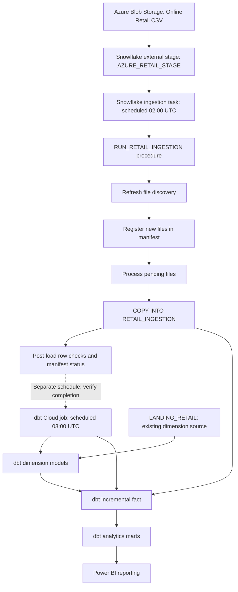

# Pipeline Orchestration and Scheduling

## Overview

The Retail Analytics Engineering Platform uses two scheduled stages:

1. **Snowflake ingestion** to discover and process files from Azure Blob Storage into the Snowflake landing table.
2. **dbt Cloud build** to transform landing data into dimension, fact, and analytics mart models, then execute the configured tests.

These are two separately scheduled workflows rather than a single end-to-end dependency-aware orchestrator. The stated schedules leave a one-hour gap between the ingestion start and dbt build start; **the gap does not itself guarantee that ingestion finished successfully before dbt begins**.

## Daily schedule

| Scheduled time (UTC) | System | Operation | Intended outcome |
|---|---|---|---|
| 02:00 | Snowflake | Execute the configured ingestion task / workflow | Identify new Azure files and load eligible transactions into `RETAIL_DB.LANDING.RETAIL_INGESTION` |
| 03:00 | dbt Cloud | Run the scheduled dbt build job | Build transformations and run dbt data-quality tests |

**Note:** Times describe the project's configured schedule, not proof of the latest successful execution. The precise Snowflake task name, warehouse, SQL task definition, dbt Cloud job ID, and job timezone settings are not supplied here; obtain those from your environment before publishing an exact deployment manifest.

## End-to-end workflow



The existing implementation uses two landing tables: dimensions read `LANDING_RETAIL`, while `FACT_SALE_INCREMENTAL` reads transactions from `RETAIL_INGESTION`. The ingestion path of `LANDING_RETAIL` is not established by the procedure shown in this portfolio; it should not be described as automatically synchronized with `RETAIL_INGESTION`.

## Snowflake ingestion workflow

The orchestration procedure `RETAIL_DB.LANDING.RUN_RETAIL_INGESTION()` coordinates three component procedures:

1. `REFRESH_AZURE_FILE_DISCOVERY()` — refreshes the list of Azure files visible to Snowflake.
2. `REGISTER_NEW_AZURE_FILES()` — records files in the ingestion manifest.
3. `PROCESS_PENDING_AZURE_FILES()` — validates, processes, and checks pending files.

Within `PROCESS_PENDING_AZURE_FILES()`, the processing loop:

- Selects `PENDING` files from `INGESTION_FILE_MANIFEST` and joins discovery metadata.
- Compares manifest and discovered **file sizes and MD5 metadata**; mismatches move to `REVIEW`.
- Checks whether the target `RETAIL_INGESTION` table already contains rows for the filename; if so, sends the file to `REVIEW` instead of reloading it.
- Sets eligible files to `LOADING`.
- Executes **`COPY INTO RETAIL_DB.LANDING.RETAIL_INGESTION`** with `FROM @RETAIL_DB.LANDING.AZURE_RETAIL_STAGE`, a per-file `FILES` clause, the configured CSV file format, and `ON_ERROR = 'ABORT_STATEMENT'`.
- Derives `SOURCE_FILENAME`, `SOURCE_ROW_NUMBER` and a SHA-256 `SOURCE_ROW_ID` based on filename and file row number.
- Checks the resulting file's total rows, distinct row IDs, and null row IDs.
- Updates the manifest to `COMPLETED` or `FAILED` (or `REVIEW` for pre-load checks).

### Manifest status values

| Status | Meaning |
|---|---|
| `PENDING` | File registered but not yet processed |
| `LOADING` | Processing attempt started |
| `COMPLETED` | Load and post-load verification succeeded |
| `FAILED` | Processing raised an error |
| `REVIEW` | File metadata mismatch or pre-existing target rows require investigation |

### Operational checks (examples)

Check ingestion outcomes:

```sql
SELECT
    FILE_STATUS,
    COUNT(*) AS FILE_COUNT,
    SUM(ROWS_LOADED) AS TOTAL_RECORDED_ROWS
FROM RETAIL_DB.LANDING.INGESTION_FILE_MANIFEST
GROUP BY FILE_STATUS
ORDER BY FILE_STATUS;
```

Check the landing table:

```sql
SELECT
    COUNT(*) AS TOTAL_ROWS,
    COUNT(DISTINCT SOURCE_ROW_ID) AS DISTINCT_ROW_IDS,
    COUNT_IF(SOURCE_ROW_ID IS NULL) AS NULL_ROW_IDS
FROM RETAIL_DB.LANDING.RETAIL_INGESTION;
```

To examine the scheduled Snowflake task, first discover its actual name:

```sql
SHOW TASKS IN SCHEMA RETAIL_DB.LANDING;
```

Then inspect the relevant task's history in Snowsight or Snowflake's task history interfaces. Task execution status is distinct from the file-level statuses tracked by the manifest.

## dbt Cloud transformation job

The scheduled **03:00 UTC** dbt Cloud job builds the project after the ingestion window. The transformation layer contains:

- Five dimensions: customer, product, date, invoice and country.
- An incremental sales fact using `SOURCE_ROW_ID`.
- Five analytical marts: monthly revenue, customer RFM, customer cohorts, product Pareto and product cancellation.
- Model and custom reconciliation tests, run through the dbt build workflow.

The core command is:

```bash
dbt build
```

Inspect the actual dbt Cloud job's execution settings and run history to confirm the command, selected environment, start time, status, and test results. If the job contains additional steps, document them from the real job configuration rather than assuming them.

### Incremental behavior

`FACT_SALE_INCREMENTAL` is configured with a dbt `merge` strategy and `SOURCE_ROW_ID` as the unique key. Its incremental SQL excludes source row IDs that already exist in the target, so normal scheduled runs behave as **insert-only**. Changes to an existing transaction row will not be incorporated automatically by the incremental filter.

## Monitoring and troubleshooting

| Symptom | First check | Response |
|---|---|---|
| New Azure file not processed | File discovery list and manifest | Confirm external stage access and whether file is `PENDING`, `REVIEW`, or `FAILED` |
| File moved to `REVIEW` | Manifest `ERROR_MESSAGE` | Investigate metadata mismatch or existing target rows before retrying |
| File marked `FAILED` | Manifest `ERROR_MESSAGE` and Snowflake query history | Correct load/data issue; reconcile partial effects before a controlled rerun |
| dbt job starts before ingestion finishes | Both job histories | Do not assume the one-hour gap enforces an execution dependency |
| dbt relationships or revenue do not reconcile | Landing-table consistency and dbt test logs | Verify that required dimension values are present and that source/fact row counts and revenue match |
| Power BI displays stale data | Power BI refresh history | Confirm model refresh occurred after successful dbt completion |

## Validation and evidence to capture for GitHub

Do not upload credentials, query history containing secrets, or private cloud identifiers. Useful non-sensitive artifacts include:

- A screenshot of the Snowflake task schedule and a successful execution.
- A sanitized manifest summary with successful file processing.
- A screenshot of the dbt Cloud job configuration and a successful `dbt build` run with test results.
- Source-to-fact financial reconciliation results.

For detailed testing expectations, see [`../docs/data_quality.md`](../docs/data_quality.md). For model lineage, see [`../docs/data_model.md`](../docs/data_model.md).

## Current limitations and improvement opportunities

1. **Time-based orchestration rather than explicit dependency:** A separate dbt schedule can start even when ingestion is slow or fails. A future enhancement could trigger the dbt job only after ingestion reports success.
2. **Two distinct landing sources:** `LANDING_RETAIL` and `RETAIL_INGESTION` are not documented as synchronized sources; their consistency should be checked when new data arrives.
3. **Insert-only incremental filter:** Existing rows are not automatically updated when their source values change.
4. **Recovery procedure:** A manifest status does not prove atomic rollback of all intermediate updates; retries should inspect both the manifest and target table.
5. **Power BI scheduling is separate:** This document does not assert that a Power BI Service scheduled refresh has been configured.

## Deployment notes

The GitHub repository is intended to explain the project, not to expose production configuration. The exported dbt project alone does not include full Snowflake scheduling configuration, cloud secrets, or Power BI Service settings. Add sanitized object definitions and screenshots only after reviewing them for sensitive information.
